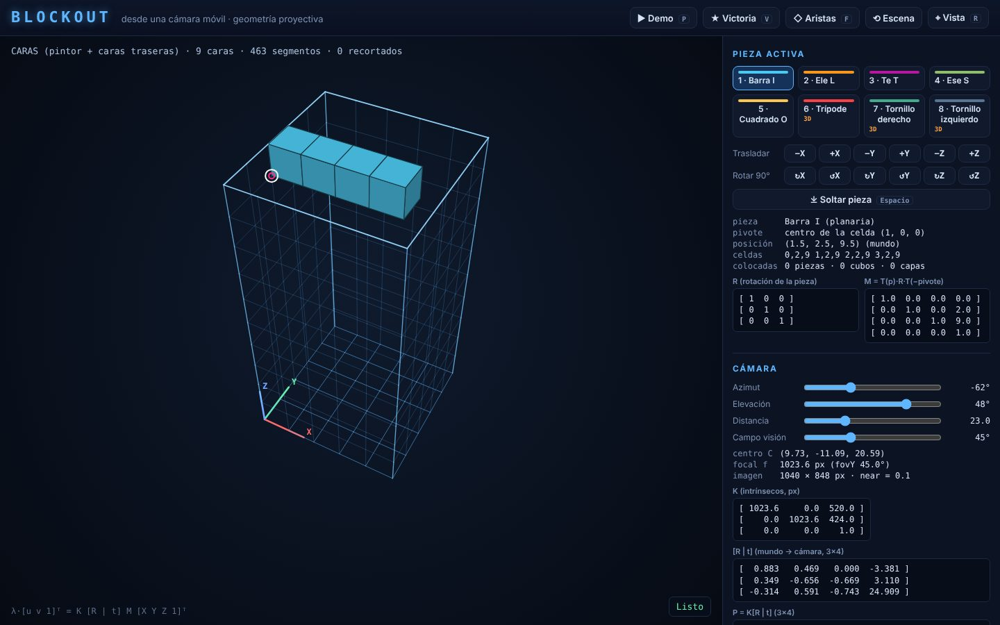

# Blockout desde una cámara móvil

Visualización 3D interactiva inspirada en *Blockout* para el curso de **Visión por Computador**
(Ingeniería Electrónica, Universidad Tecnológica de Pereira, 2026‑II). La escena vive en coordenadas 3D
del mundo y se proyecta sobre la pantalla con una cámara construida explícitamente:

```
λ·[u v 1]ᵀ = K [R | t] M [X Y Z 1]ᵀ
```



Ninguna cámara de motor gráfico interviene: las transformaciones, `K`, `R`, `t`, el recorte en el plano
cercano y la división en perspectiva están escritas a mano en JavaScript, y el lienzo 2D solo dibuja
los polígonos y líneas ya proyectados.

## Ejecutar en Linux

No hay dependencias ni servidor. Basta un navegador moderno (Firefox ≥ 100 o Chromium ≥ 100).

```bash
git clone <URL-del-repositorio>
cd blockout-vision
xdg-open index.html            # o: firefox index.html  /  chromium index.html
```

- **Demostración automática:** abrir `index.html?demo`, o pulsar **P** dentro de la aplicación.
- **Pruebas en el navegador:** abrir `tests/test.html`.
- **Pruebas en la terminal** (opcional, requiere Node.js ≥ 18): `node tests/run-tests.js`
- **Experimento de la homografía:** `node tests/homography-experiment.js --md docs/RESULTADOS_HOMOGRAFIA.md`

Todos los recursos están en el repositorio: no se usan CDNs, fuentes web ni servicios externos.

## Controles

| Tecla / gesto | Acción |
|---|---|
| ← → ↑ ↓ | trasladar la pieza en X/Y (el eje del mundo más alineado con la pantalla) |
| Mayús + ↑ ↓ · RePág / AvPág | trasladar en Z |
| Q / A · W / S · E / D | rotar ±90° alrededor de X · Y · Z (pivote: centro de la celda pivote) |
| 1 – 8 | seleccionar pieza |
| Espacio | soltar la pieza (se fija; las capas completas se eliminan) |
| arrastrar con el ratón · J / L · I / K | orbitar la cámara (azimut · elevación) |
| rueda · U / O | distancia de observación |
| Mayús + rueda · N / M | campo de visión / distancia focal |
| R | restablecer la vista inicial |
| F | alternar caras rellenas / solo aristas |
| T | siguiente vértice en la traza objeto → pantalla |
| H | fijar la vista actual como «vista 1» del experimento de homografía |
| V | animación de victoria |
| P | iniciar / detener la demostración |
| Retroceso | reiniciar la escena |

El panel lateral muestra la pieza activa (pose, `R`, `M`), la cámara (`K`, `[R|t]`, `P`, `f`),
la traza paso a paso de un vértice y el experimento de homografía con sus errores en píxeles.

## Estructura

```
index.html            página principal (scripts clásicos → funciona con file://)
css/style.css
js/math/linalg.js     álgebra lineal propia (producto, inversa, rotaciones, Jacobi)      — compartido
js/scene/pieces.js    8 policubos y su malla (caras exteriores, normales, aristas)       — A
js/scene/scene.js     estado, poses, M, acciones, geometría para proyectar               — A
js/camera/camera.js   K, R, t, P; órbita, distancia y campo de visión                    — B
js/camera/projection.js  cadena K[R|t]M, recorte z = near, caras traseras, pintor        — B
js/camera/homography.js  homografía del fondo, DLT normalizada, experimento              — B
js/app/renderer.js    dibujo 2D de primitivas                                            — C
js/app/input.js       teclado/ratón → acciones                                           — C
js/app/victory.js     animación de victoria por poses 3D                                 — C
js/app/demo.js        demostración determinista (reloj de paso fijo)                     — C
js/app/main.js        bucle, estado de la interfaz y paneles                             — C
tests/                pruebas (Node y navegador) y experimento de la homografía
docs/                 interfaces, plan, informe, resultados, contribuciones
```

## Documentación

- [Documento de interfaces](docs/INTERFACES.md) — convenciones, estructuras, funciones, ejemplo compartido
- [Plan, cronograma y seguimiento](docs/PLAN.md) — roles y responsable de seguimiento
- [Informe](docs/INFORME.md) — cadena de proyección, homografía, resultados, limitaciones
- [Resultados numéricos de la homografía](docs/RESULTADOS_HOMOGRAFIA.md)
- [Contribuciones](docs/CONTRIBUCIONES.md)
- [Uso de IA](AI_USAGE.md)

## Flujo de trabajo

`main` siempre ejecutable; una rama por funcionalidad; integración solo por *pull request* con la
aprobación de un compañero distinto del autor (rotación A → B → C → A). Ver [CONTRIBUTING.md](CONTRIBUTING.md).
