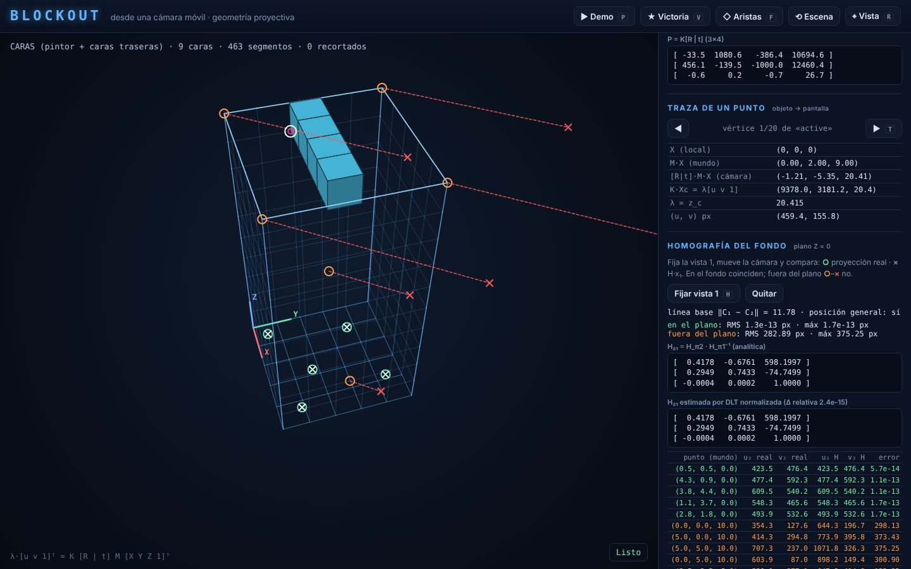
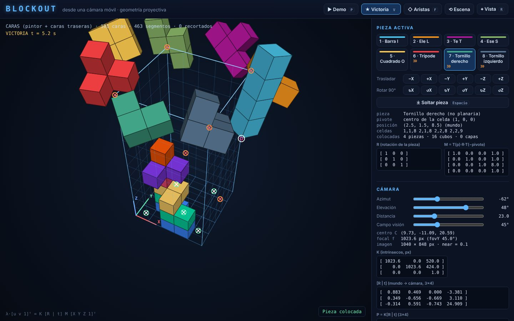
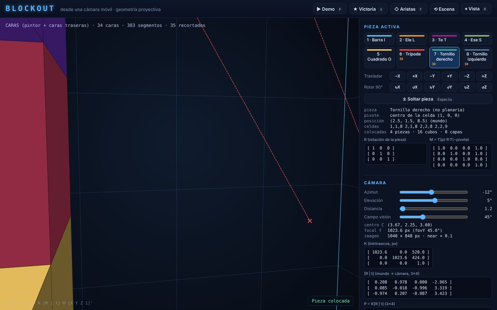
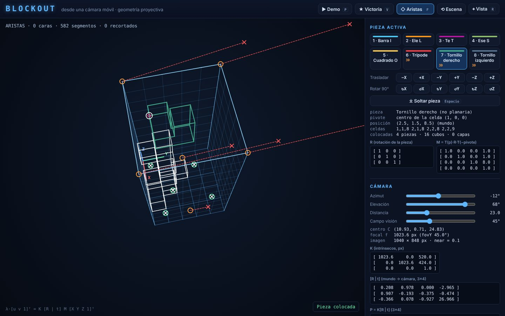

# Informe: Blockout desde una cámara móvil

Visión por Computador

## 1. Resumen

La aplicación representa un contenedor de 5×5×10 cubos y ocho piezas (policubos de cuatro cubos, tres de
ellas no planarias) en coordenadas 3D del mundo. Cada cuadro, la escena se proyecta sobre un lienzo 2D con
una cámara de agujero construida explícitamente. La cámara orbita, se acerca y cambia su distancia focal
sin tocar la escena. Una animación de victoria y una demostración determinista usan la misma cadena de
proyección. Un experimento compara la homografía inducida por el fondo del contenedor entre dos vistas
con la proyección real y muestra por qué no sirve para puntos fuera del plano.

## 2. Cadena de proyección

Para un vértice con coordenadas locales `X = (X, Y, Z)` de un objeto:

```
λ·[u v 1]ᵀ = K · [R | t] · M · [X Y Z 1]ᵀ
             3×3   3×4     4×4    4×1
```

**Modelo → mundo (M, 4×4).** La pose de una pieza es `(p, R_p)`: la posición en el mundo del pivote (centro
de la celda pivote `c`) y una rotación propia. Entonces `M = T(p) · [R_p 0; 0 1] · T(−(c + ½))`. Las
rotaciones del usuario son `R_p ← Rot₉₀(eje, ±1) · R_p` con matrices de entradas enteras (sin deriva
numérica) y alrededor del eje del mundo que pasa por el pivote. Como el pivote es el centro de una celda,
los centros de celda siguen siendo centros de celda: la pieza queda en la rejilla y conserva su rigidez
(pruebas «rotaciones conservan la rigidez» y «cuatro rotaciones devuelven la pieza»).

**Mundo → cámara ([R | t], 3×4).** El centro óptico orbita el objetivo `T` en coordenadas esféricas:
`C = T + ρ (cos e cos a, cos e sin a, sin e)`. Las filas de `R` son los ejes de la cámara en el mundo:
adelante `r₃ = (T − C)/‖T − C‖`, derecha `r₁ = r₃ × ẑ / ‖·‖`, abajo `r₂ = r₃ × r₁`. Así
`X_c = R (X_w − C) = R X_w + t` con `t = −R C`. La elevación se limita a ±89° para que `r₃ × ẑ ≠ 0`.

**Cámara → imagen (K, 3×3).** `K = [[f, 0, c_x], [0, f, c_y], [0, 0, 1]]`, con `f = (h/2)/tan(fovY/2)` en
píxeles y el punto principal en el centro del lienzo. Las imágenes usan `u` hacia la derecha y `v` hacia
abajo, coherente con `y_c` hacia abajo, por lo que no hace falta ningún cambio de signo al dibujar.

**División en perspectiva.** `K X_c = (λu, λv, λ)` con `λ = z_c`; `(u, v) = (λu/λ, λv/λ)`.

### 2.1 Puntos detrás de la cámara

Antes de dividir, cada arista se recorta contra el plano `z_c = near = 0.1` y cada cara con
Sutherland–Hodgman contra el mismo plano. Lo que queda completamente detrás se descarta. Por construcción
nunca se divide por `λ ≤ near`, y la aplicación funciona con la cámara dentro del contenedor (prueba
«puntos detrás de la cámara … no producen NaN»; el HUD muestra cuántas primitivas se recortan).

### 2.2 Visibilidad

Con caras rellenas se usan dos mecanismos coherentes:

1. **Eliminación de caras traseras**: las caras se generan en sentido antihorario visto desde fuera; tras la
   transformación rígida (det = +1), una cara es visible si `n_c · X_c < 0`, con `n_c` su normal en
   coordenadas de cámara.
2. **Algoritmo del pintor**: todas las primitivas (caras y segmentos de la rejilla, partidos en tramos
   unitarios) se ordenan por profundidad media `z̄_c` y se dibujan de la más lejana a la más cercana.

Las caras interiores entre cubos de una misma pieza no se generan, así que cada pieza es una superficie
cerrada (cada arista pertenece exactamente a dos caras y el volumen calculado con el teorema de la
divergencia es 4). El modo «solo aristas» (F) dibuja las aristas de contorno sin rellenos.

### 2.3 Traza de un punto

El panel «Traza de un punto» muestra, para cualquier vértice de la pieza activa, `X`, `M·X`, `[R|t]·M·X`,
`K·X_c = λ[u v 1]`, `λ` y `(u, v)`, y lo marca en pantalla. El ejemplo compartido del documento de
interfaces (`(1,2,3) → (511.111, 133.333)`) se verifica en las pruebas.

## 3. Homografía inducida por el fondo del contenedor

### 3.1 Distinción de términos

- `P` (3×4) proyecta el espacio 3D en la imagen; pierde una dimensión y **no es una homografía**.
- Una transformación proyectiva de 3D es una matriz 4×4 no singular. `M` y `[R t; 0 1]` son casos
  particulares rígidos.
- Una **homografía** entre imágenes de un plano es una matriz 3×3 no singular: transforma el plano
  proyectivo en sí mismo.

### 3.2 Derivación

El fondo es el plano `π: Z = 0`. Un punto del fondo es `X̃ = (x, y, 0, 1)ᵀ`, y si `pₖ` es la columna `k` de `P_i`:

```
λ x_i = P_i X̃ = x p₁ + y p₂ + 0·p₃ + p₄ = [p₁ p₂ p₄] (x, y, 1)ᵀ = H_πi (x, y, 1)ᵀ
```

`H_πi` (3×3) lleva coordenadas del plano a la imagen `i`. Si el centro óptico no está en el plano, es
invertible, y para las dos vistas

```
x₂ ~ H_π2 H_π1⁻¹ x₁ = H₂₁ x₁        (H₂₁ normalizada con h₃₃ = 1)
```

**Comprobación independiente.** Con el movimiento relativo `X_c2 = R X_c1 + t`, `R = R₂R₁ᵀ`,
`t = t₂ − R t₁`, y el plano expresado en la cámara 1 como `nᵀ X_c1 = d` (`n = R₁ ẑ`, `d = nᵀ t₁`), para
puntos del plano `nᵀX_c1/d = 1`, de modo que

```
X_c2 = R X_c1 + t (nᵀ X_c1)/d = (R + t nᵀ/d) X_c1   ⇒   H₂₁ = K₂ (R + t nᵀ/d) K₁⁻¹
```

Ambas expresiones coinciden numéricamente (diferencia relativa < 10⁻¹²; prueba «columnas de P coinciden
con K2(R + t nᵀ/d)K1⁻¹»).

### 3.3 Por qué no sirve fuera del plano

Para un punto cualquiera, `X_c2 = (R + t nᵀ/d) X_c1 + t (1 − nᵀX_c1/d)`. Proyectando:

```
x₂ ~ H₂₁ x₁ + ρ · e₂ ,     e₂ = K₂ t (epipolo en la vista 2),     ρ = (d − nᵀ X_c1) / (d · z_c1)
```

El segundo término es el **paralaje** respecto al plano. Se anula solo si:

- el punto está en el plano (`nᵀX_c1 = d`), o
- `t = 0`, es decir `C₂ = C₁` (`t = R₂(C₁ − C₂)`): **la cámara solo rotó**. Entonces
  `H = K₂ R₂ R₁ᵀ K₁⁻¹` transfiere todos los puntos, estén o no en el plano.

En general, cuando cambia el centro de la cámara, el error crece con la altura del punto sobre el fondo y
con la línea base. La prueba «el error fuera del plano es el paralaje» comprueba la fórmula de `x₂`
completa con una tolerancia de 10⁻⁸ px.

### 3.4 Experimento numérico

Vista 1: azimut −62°, elevación 48°, distancia 23, fovY 45°. Vista 2: azimut −7°, elevación 70°,
distancia 18, fovY 55°. Imagen de 960×720 px, línea base 12.9 unidades. Se usan cinco puntos del fondo
sin tres colineales y seis puntos fuera del plano. Tabla completa en
[RESULTADOS_HOMOGRAFIA.md](RESULTADOS_HOMOGRAFIA.md); se regenera con
`node tests/homography-experiment.js --md docs/RESULTADOS_HOMOGRAFIA.md`.

| Conjunto | RMS (px) | máximo (px) |
|---|---|---|
| 5 puntos del fondo (Z = 0) | 7.2 × 10⁻¹⁴ | 1.3 × 10⁻¹³ |
| 6 puntos fuera del plano | 290.4 | 382.6 |

| Punto fuera del plano | altura Z | error (px) |
|---|---|---|
| (5, 2.5, 2) | 2 | 46.3 |
| (2.5, 2.5, 5) | 5 | 127.9 |
| esquinas del borde superior | 10 | 316 – 383 |

- En el plano, el error es del orden del épsilon de máquina: `H₂₁` es exacta.
- La DLT normalizada (Hartley) con los cinco puntos recupera `H₂₁` con diferencia relativa ≈ 10⁻¹⁴, lo que
  confirma la homografía desde las correspondencias de imagen sin usar las matrices de cámara.
- Fuera del plano el error crece con Z, como predice `ρ`.
- **Control**: si la vista 2 es la vista 1 rotada sin mover C, todos los puntos (incluidos los de Z = 10) se
  transfieren con error < 5 × 10⁻¹³ px.

En la aplicación, **H** fija la vista actual como vista 1. Al mover la cámara, cada punto de prueba se
dibuja con un círculo (proyección real con la cámara actual) y una cruz (`H₂₁ x₁`). En el fondo coinciden;
fuera del plano los separa una línea roja. El panel muestra ambas matrices y la tabla de errores en vivo.



## 4. Animación de victoria y demostración

La victoria (`js/app/victory.js`) calcula para cada instante `t` una pose rígida por pieza: órbita con giro
propio (0–3 s), vuelo a una «corona» sobre el contenedor (3–6 s) y giro y rebote de la corona ensamblada
(6–9 s). Las poses entran por `applyAction({type:'SET_ANIMATION'})` y se proyectan con la misma
`K[R|t]M`; la cámara sigue controlable. La demostración (`js/app/demo.js`) es una lista fija de eventos
con un reloj de paso fijo (1/60 s por cuadro). Dos reproducciones generan exactamente la misma secuencia
de estados (prueba automática).

| Victoria (t ≈ 5 s) | Cámara dentro del contenedor: recorte en z_c = near | Modo solo aristas |
|---|---|---|
|  |  |  |

## 5. Verificación

`node tests/run-tests.js` (o `tests/test.html` en el navegador) ejecuta 23 pruebas: álgebra (inversa,
Jacobi, espacio nulo), mallas cerradas, rigidez y límites, ejemplo compartido, rotaciones propias, recorte,
orden del pintor, homografía (exactitud en el plano, DLT, forma `K(R + tnᵀ/d)K⁻¹`, paralaje, fallo fuera
del plano, rotación pura), integración escena → pantalla, rigidez y continuidad de la victoria, y
determinismo de la demostración. Además, la aplicación se abrió con `file://` en Chromium sobre Linux sin
errores de consola.

## 6. Limitaciones conocidas

- **Algoritmo del pintor**: ordena por profundidad media. Puede fallar con solapamientos cíclicos o
  polígonos muy grandes recortados, y entre segmentos de la rejilla y caras casi coplanares. No se usa
  búfer de profundidad por píxel.
- **Elevación** limitada a ±89° para evitar la singularidad de `r₃ × ẑ`; no hay vista cenital exacta.
- **Juego simplificado**: sin caída automática ni puntuación. Las colisiones se comprueban solo contra
  cubos colocados y paredes; al llenarse el contenedor, el fondo se vacía.
- **Demostración**: es determinista en estados, pero dura más en tiempo real si el navegador no alcanza
  60 cuadros/s.
- La rueda del ratón y los atajos dependen del navegador; se ofrecen botones y deslizadores equivalentes.
